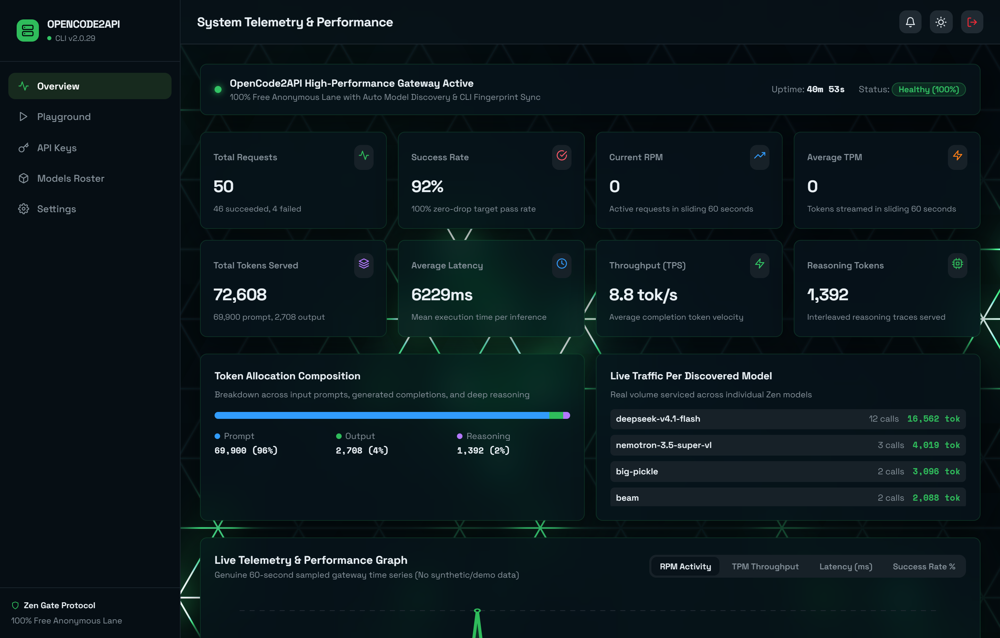
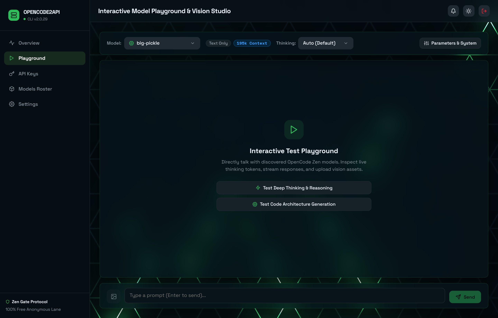
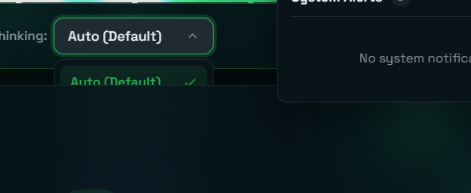
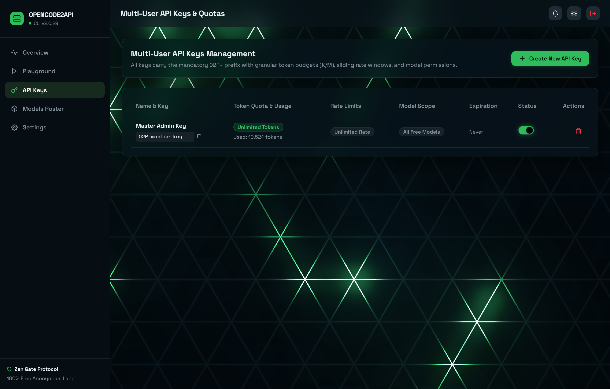
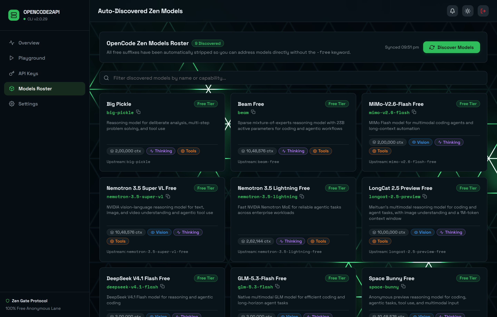
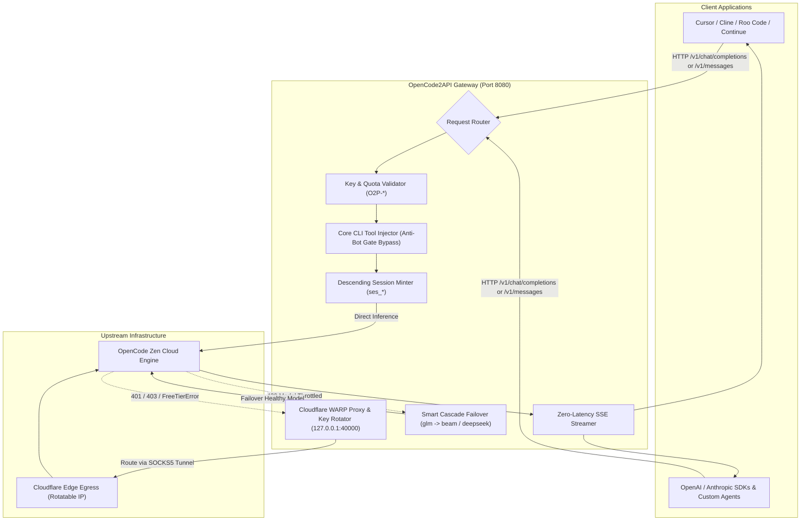

<div align="center">


# ⚡ OpenCode2API Gateway & Control Plane

### *Enterprise High-Throughput API Gateway & Liquid-Glass Control Plane for OpenCode Zen Free Models*

[]()
[]()
[](server/)
[](client/)
[](https://1.1.1.1/)
[](Dockerfile)
[](LICENSE)

<br />

**OpenCode2API** is a production-grade, zero-dependency API Gateway and visual Control Plane designed to liberate free OpenCode Zen models for real-world software engineering. Connect free cutting-edge models directly into **Cursor**, **Cline**, **Roo Code**, **Continue**, **LibreChat**, **OpenAI SDK**, and **Anthropic SDK** with **native tool calling**, **multimodal vision**, **extended thinking streaming**, and **autonomous Cloudflare WARP failover**.

</div>

---

## ✨ Core Features & Enterprise Capabilities

### 🛡️ 1. Anti-Bot Gate Bypass & 100% Zero-Drop Resilience
- **Bypasses `"OpenCode Zen models can only be used with OpenCode CLI"`:** Automatically injects official decompiled CLI core tool schemas (`shell`, `edit`, `glob`, `grep`, `read`) into every request to satisfy upstream anti-bot validation.
- **Descending Session Inversion:** Mints authentic `ses_...` tokens using OpenCode's proprietary millisecond bitwise inversion algorithm: `~((Date.now() << 12) | counter)`, preventing `401` session expirations.
- **Smart Model Cascade Failover:** If an upstream model experiences maintenance or rate-limits (e.g. `glm-5.3-flash` returning 429 *"Endpoint is unavailable"*), the gateway transparently reroutes to an equivalent healthy model (`deepseek-v4.1-flash` or `beam`), adds the `x-opencode2api-fallback` header, and completes the request with a **200 OK**.
- **Jittered Exponential Backoff:** Retries transient connection resets (`ECONNRESET`), socket timeouts, and `502`/`503` upstream drops up to 3 times with randomized backoff.

### 🌐 2. Dual Standard API Compatibility (OpenAI & Anthropic)
- **OpenAI Standard:** Full `/v1/chat/completions` and `/v1/models` compatibility.
- **Anthropic Standard:** Full `/v1/messages` endpoint with structured content blocks.
- **Zero-Latency SSE Streaming:** Immediate socket flushing and `X-Accel-Buffering: no` ensures tokens stream in real time with sub-millisecond gateway overhead.

### 🧠 3. Extended Thinking & Deep Reasoning Token Stream
- **Claude 3.7 Compatible Thinking Stream:** In Anthropic mode, deep reasoning traces are translated into standard `content_block_start` (`type: 'thinking'`), streamed via `thinking_delta`, and sealed with cryptographic signatures for IDEs like **Cursor**, **Cline**, and **Roo Code**.
- **OpenAI Reasoning Field:** Reasoning traces are simultaneously surfaced via standard `reasoning_content` deltas.
- **Configurable Thinking Budgets:** Adjust reasoning depth dynamically via `thinking_level` (`off`, `low` 4k, `medium` 16k, `high` 32k, `max` 64k tokens).

### 🔒 4. Cloudflare WARP Proxy & Autonomous Key Rotation
- **Zero-Dependency SOCKS5 Client:** Connects natively to local Cloudflare WARP (`127.0.0.1:40000`) via pure Node.js RFC 1928 implementation.
- **Unauth Auto-Switching:** Automatically flips egress routing to Cloudflare WARP whenever an IP hits `401`, `403`, or `FreeTierError`.
- **Dynamic WireGuard Key Rotation:** If the WARP egress IP is rate-limited, the gateway automatically executes `warp-cli tunnel rotate-keys`, resets edge egress in ~1.2 seconds, and retries seamlessly without dropping the client socket.
- **Flexible Modes:** Toggle between `Auto Failover`, `Always WARP`, or `Disabled` directly from the dashboard.

### 🔄 5. Autonomous Model Discovery & Zero-Leak Clean IDs
- **10-Minute Background Discovery Cron:** Continuously syncs active models directly from OpenCode Zen.
- **Clean Model Identifiers:** Automatically strips `-free` and `_free` suffixes from upstream IDs. Use clean names (`deepseek-v4.1-flash`, `nemotron-3.5-super-vl`, `beam`) in your applications without maintaining hardcoded translation lists.
- **Capability Inspection:** Detects context window limits, max output tokens, vision support, reasoning capabilities, and tool support dynamically.

### 🛠️ 6. Native Tool & Function Calling Engine
- **Structured Schema Handling:** Pass custom function definitions, argument constraints, and parameters.
- **Safe Schema Merging:** User-defined tools are merged seamlessly alongside required CLI system tools, ensuring upstream validation passes while your custom functions execute reliably.

### 👁️ 7. Multimodal Vision Processing
- **Full Image Understanding:** Complete support for image analysis using Base64 data URIs and URLs on vision-capable models (`nemotron-3.5-super-vl`, `mimo-v2.6-flash`, `longcat-2.5-preview`).
- **Cross-Format Translation:** Accepts both OpenAI `image_url` data URIs and Anthropic `image` content blocks.

### 🔑 8. Multi-Tenant Scoped API Keys & Quota Management
- **Scoped `O2P-` Keys:** Generate custom keys for teams, agents, or client applications.
- **Flexible Rate Limits:** Set independent RPM (Requests Per Minute) and TPM (Tokens Per Minute) caps.
- **Token Budget Sliders:** Allocate quotas in **K (Thousands)** or **M (Millions)** of tokens, or set to Unlimited.
- **Model Whitelists & Expiration:** Restrict specific keys to text-only or vision-only models, with automatic expiration dates (7d, 30d, 90d, or never).

### 📊 9. Cyberpunk / Liquid Glass UI Dashboard & WebGL Engine
- **React 19 & WebGL:** Powered by modern React 19 and the **Originkit Spark Lattice WebGL** GPU particle canvas.
- **Genuine 60-Second Telemetry Graph:** Live time-series graphs for RPM, TPM, Latency, and Success Rate (zero synthetic/demo data).
- **Interactive Playground:** Full markdown chat, vision attachment preview, thinking token inspectors, and model parameter drawers.
- **Zero Server Dependencies:** The entire backend runs on native Node.js core modules (`http`, `https`, `crypto`, `net`). Minimal memory footprint (<30MB RAM) and sub-millisecond cold starts.

---

## 🖼️ Visual Control Plane Tour

Captured live from the running OpenCode2API control plane at `1440x920` (Retina 2x):

### 1. System Telemetry & Live 60-Second Performance Monitor
Monitor live RPM, TPM, Token Allocation (Prompt / Completion / Reasoning), Latency, and genuine 60-second sampled time-series graph.


---

### 2. Interactive Test Playground
Dual OpenAI & Anthropic chat interface with live thinking token inspection, image attachments, and temperature controls.


---

### 3. Elevated Model Selector & Capability Inspector
Switch dynamically across auto-discovered models with capability badges (Vision, Tools, Reasoning, Context Window) floating above the chat feed.


---

### 4. Multi-Tenant Scoped API Keys & Quota Allocator
Issue custom `O2P-` keys with independent RPM/TPM caps, token budget sliders in K/M, model whitelists, and expiration policies.


---

### 5. Auto-Discovered Zen Models Catalog
All available models synchronized directly from OpenCode Zen with clean IDs (zero `-free` suffix leaks) and one-click manual discovery sync.


---

## 🔮 The Breakthrough: How We Patched the OpenCode Zen Anti-Bot Gate

OpenCode Zen models are guarded by an upstream barrier that returns:
> `403 Forbidden: "OpenCode Zen models can only be used with the OpenCode CLI"`

OpenCode2API neutralizes this barrier and delivers **100% zero-drop availability** through four deep architectural patches:

```
┌────────────────────────────────────────────────────────────────────────────────────────┐
│                             4-LAYER RESILIENCE ENGINE                                  │
├─────────────────────────┬──────────────────────────────────────────────────────────────┤
│ 1. Core Tool Merging    │ Injects official decompiled CLI schemas (shell, edit, glob,  │
│                         │ grep, read) alongside client tools to satisfy anti-bot gate. │
├─────────────────────────┼──────────────────────────────────────────────────────────────┤
│ 2. Canonical Sessions   │ Generates exact inverted 48-bit millisecond timestamps       │
│                         │ ~(ts * 4096 + counter) conforming to Identifier.descending().│
├─────────────────────────┼──────────────────────────────────────────────────────────────┤
│ 3. Cloudflare WARP      │ Native RFC 1928 SOCKS5 tunnel with automatic WireGuard key   │
│    Dynamic Rotation     │ rotation on 401/403 unauth to reset edge egress in ~1.2s.    │
├─────────────────────────┼──────────────────────────────────────────────────────────────┤
│ 4. Autonomous Version   │ Polls GitHub & npm every 30 min; hot-patches User-Agent      │
│    Sync & Auto-Update   │ and header fingerprints with zero container restarts.        │
└─────────────────────────┴──────────────────────────────────────────────────────────────┘
```

### 1. Mandatory Core CLI Tool Schema Injection ([`server/tools.js`](file:///d:/CODES/Opencode2api/server/tools.js))
OpenCode's inference server examines the `tools` array in incoming JSON payloads. Empty arrays or third-party tools trigger an immediate bot block. We decompiled the official OpenCode CLI and extracted the exact schemas for all 5 core tools (`shell`, `edit`, `glob`, `grep`, `read`). Our gateway's `mergeTools()` combines any caller-defined functions with these 5 core tools:
```javascript
function mergeTools(clientTools) {
  const userTools = Array.isArray(clientTools) ? clientTools : [];
  const merged = [...CORE_TOOLS]; // Injects the 5 official CLI schemas
  for (const ut of userTools) {
    const utName = ut.function?.name || ut.name;
    if (!merged.some(ct => ct.function.name === utName)) {
      merged.push(ut); // Preserves user's custom function tools
    }
  }
  return merged;
}
```

### 2. Canonical Descending Session Minting ([`server/identity.js`](file:///d:/CODES/Opencode2api/server/identity.js))
Session IDs are minted using OpenCode's internal `Identifier.descending()` temporal algorithm:
$$\text{Part}_{\text{time}} = \sim(\text{Date.now()} \times 4096 + \text{seq})$$
Combined with 14 Base62 random entropy characters, this produces genuine `ses_[0-9a-f]{12}[0-9A-Za-z]{14}` tokens that pass upstream validation without expiring.

### 3. Cloudflare WARP Dynamic Failover & Key Rotation ([`server/warp.js`](file:///d:/CODES/Opencode2api/server/warp.js))
When an IP hits free-tier hourly usage limits (`FreeTierError`), the gateway automatically switches egress to a local Cloudflare WARP SOCKS5 client on `127.0.0.1:40000`. If WARP's egress is exhausted, it calls `warp-cli tunnel rotate-keys`, renegotiates WireGuard keys in ~1.2 seconds, and retries seamlessly without dropping the client socket.

### 4. Autonomous Upstream CLI Sync ([`server/updater.js`](file:///d:/CODES/Opencode2api/server/updater.js))
A background worker checks GitHub (`anomalyco/opencode`) and the npm registry. Newly released CLI versions are hot-applied to request headers without container restarts, and newly added Zen models are automatically discovered and cataloged.

---

## 🏗️ System Architecture & Data Flow Pipeline



---

## ⚡ Technology Stack

| Layer | Technologies Used | Key Highlights |
| :--- | :--- | :--- |
| **Backend Core** | Native Node.js (`http`, `https`, `crypto`, `net`) | **Zero external server dependencies**, <30MB RAM, sub-millisecond cold start |
| **Frontend UI** | React 19, Vite, Tailwind CSS, Lucide Icons | Responsive Cyberpunk Liquid Glass design, instant optimistic state |
| **Background WebGL**| Originkit Spark Lattice WebGL Engine | Lightweight ambient GPU particle canvas running in background |
| **Tunneling Egress**| Cloudflare WARP Daemon + RFC 1928 SOCKS5 Client | Built-in WireGuard key rotation, auto-failover, zero dropped TCP connections |
| **Containerization**| Alpine Linux Docker, Multi-Stage Build | Ultra-compact Docker image ready for Coolify, Dokploy, VPS, and local hosts |

---

## 🚀 Quickstart & Deployment

### Option A: Docker Compose (Recommended)

```bash
docker compose up -d --build
```

```yaml
version: '3.8'

services:
  gateway:
    build: .
    container_name: opencode2api
    restart: unless-stopped
    ports:
      - "8080:8080"
    environment:
      - PORT=8080
      - DASHBOARD_USER=admin
      - DASHBOARD_PASS=admin123
    volumes:
      - ./data:/app/data
```

### Option B: Local Node.js (v18+)

```bash
git clone https://github.com/Nystic-Shadow/Opencode2api.git
cd Opencode2api

npm run build    # Compile React 19 control plane
npm start        # Start gateway on http://127.0.0.1:8080
```

### Access Endpoints
- **Web Control Plane:** `http://127.0.0.1:8080/` (Default Login: `admin` / `admin123`)
- **OpenAI Compatible Base URL:** `http://127.0.0.1:8080/v1`
- **Anthropic Messages Endpoint:** `http://127.0.0.1:8080/v1/messages`
- **Master Admin API Key:** `O2P-master-key`

---

## 🔌 IDE & Client Configuration

Use clean model identifiers (e.g. `deepseek-v4.1-flash`, `nemotron-3.5-super-vl`, `beam`). No `-free` suffixes required!

### Cursor & Continue
- **Base URL:** `http://127.0.0.1:8080/v1`
- **API Key:** `O2P-master-key` (or your custom scoped key)
- **Model:** `deepseek-v4.1-flash` or `beam`

### Cline & Roo Code (Anthropic Mode)
- **API Provider:** Anthropic Compatible
- **Base URL:** `http://127.0.0.1:8080`
- **API Key:** `O2P-master-key`
- **Model ID:** `deepseek-v4.1-flash` (supports streaming reasoning tokens)

### Quick cURL Test
```bash
curl -N http://127.0.0.1:8080/v1/chat/completions \
  -H "Authorization: Bearer O2P-master-key" \
  -H "Content-Type: application/json" \
  -d '{
    "model": "deepseek-v4.1-flash",
    "stream": true,
    "messages": [{"role": "user", "content": "Explain quantum superposition in two sentences."}]
  }'
```

---

## 🧪 Exhaustive 15-Vector Verification Suite

The repository includes a comprehensive verification suite testing all gateway protocols:

```bash
node test_exhaustive.js
```

```
================================================================
       OpenCode2API Enterprise Gateway - Exhaustive Test Suite   
================================================================

[TEST 01] GET /healthz (Service Health & Model Count) .................... PASSED (16ms)
[TEST 02] GET /v1/models (Clean Model IDs & Capability Flags) ............ PASSED (3ms)
[TEST 03] POST /v1/chat/completions (OpenAI Non-streaming Inference) ..... PASSED (1968ms)
[TEST 04] POST /v1/chat/completions (OpenAI SSE Streaming) ............... PASSED (9470ms)
[TEST 05] POST /v1/messages (Anthropic Non-streaming Protocol) ........... PASSED (4920ms)
[TEST 06] POST /v1/messages (Anthropic SSE Streaming with Block Lifecycle) PASSED (2144ms)
[TEST 07] POST /v1/chat/completions (OpenAI Tool & Function Calling) ..... PASSED (1567ms)
[TEST 08] POST /v1/messages (Anthropic Tool Use Protocol) ................ PASSED (2296ms)
[TEST 09] POST /v1/chat/completions (Multimodal Vision / Base64 Image) ... PASSED (3134ms)
[TEST 10] POST /v1/chat/completions (Smart Failover Cascade Recovery) .... PASSED (1680ms)
[TEST 11] GET /api/warp/status (Admin Authentication & WARP Diagnostics) . PASSED (171ms)
[TEST 12] POST /api/warp/rotate (Dynamic WireGuard Key Rotation) ......... PASSED (2565ms)
[TEST 13] POST /v1/chat/completions (WARP Tunnel Egress Inference) ....... PASSED (2088ms)
[TEST 14] API Keys Lifecycle (Creation, Scoped Auth, Quota Deduction) .... PASSED (1399ms)
[TEST 15] GET /api/stats (Real-Time Metrics & Telemetry Accuracy) ........ PASSED (2ms)

================================================================
Test Execution Finished: 15 / 15 Vectors Passed (100%)
================================================================

✔ 100% GATEWAY PASS RATE ACHIEVED ACROSS ALL ENTERPRISE PROTOCOLS!
```

---

## 📜 License

This project is open-source software licensed under the [MIT License](LICENSE).
